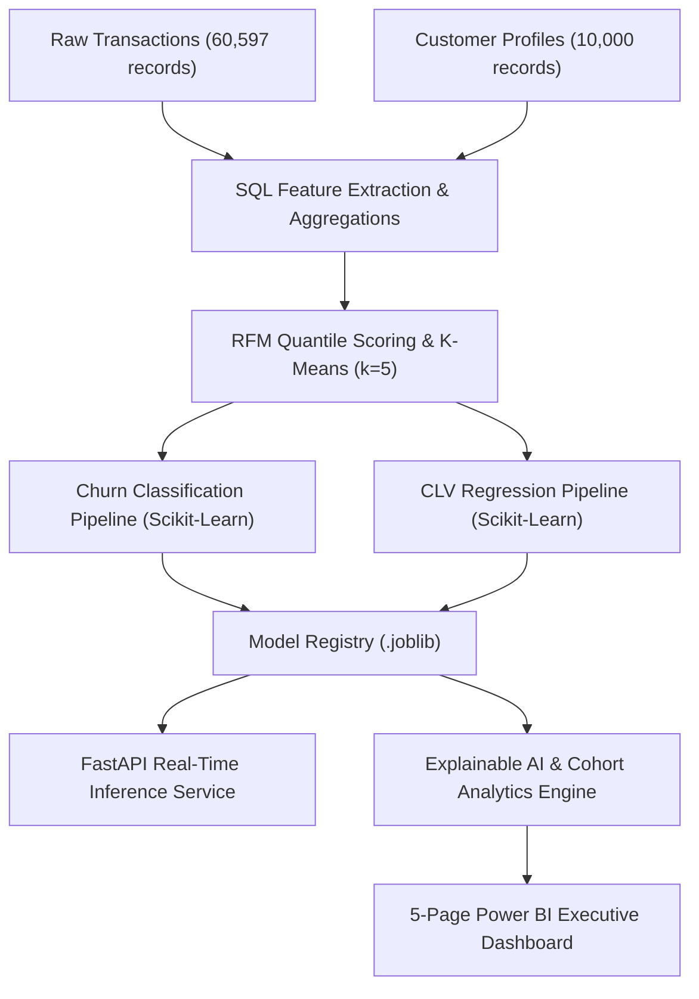
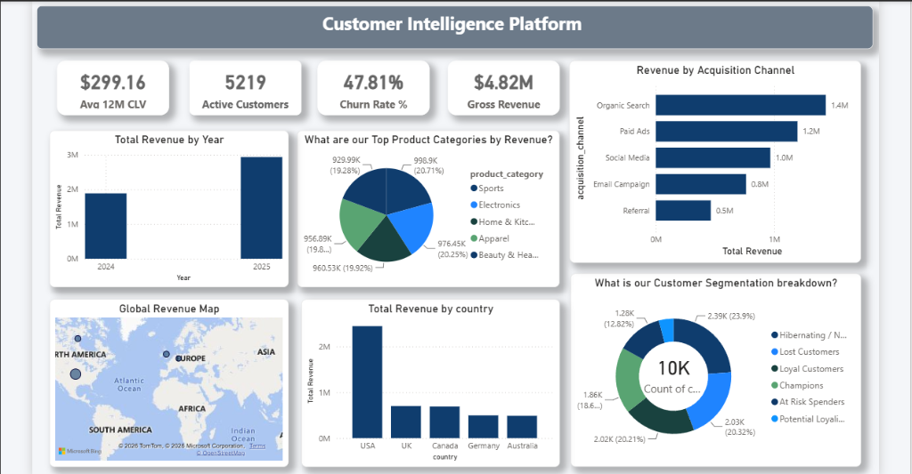
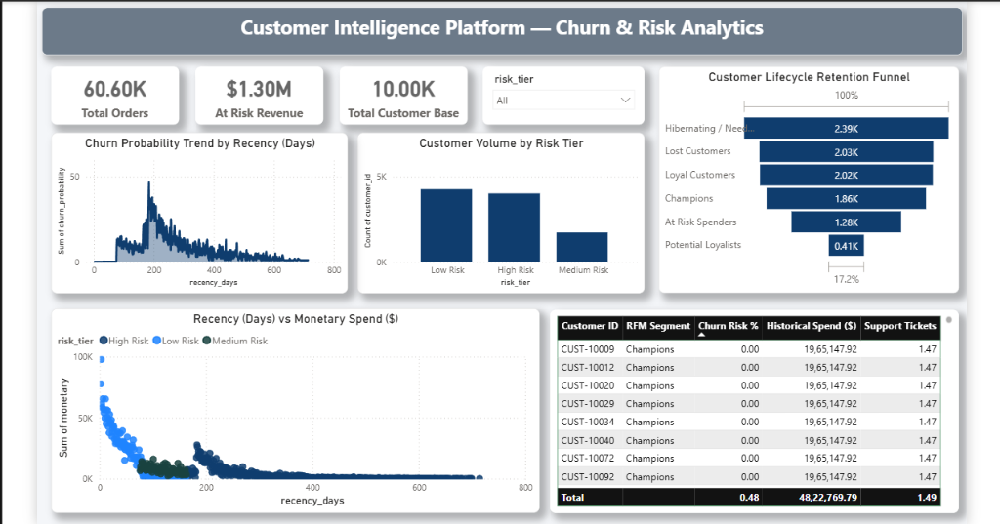
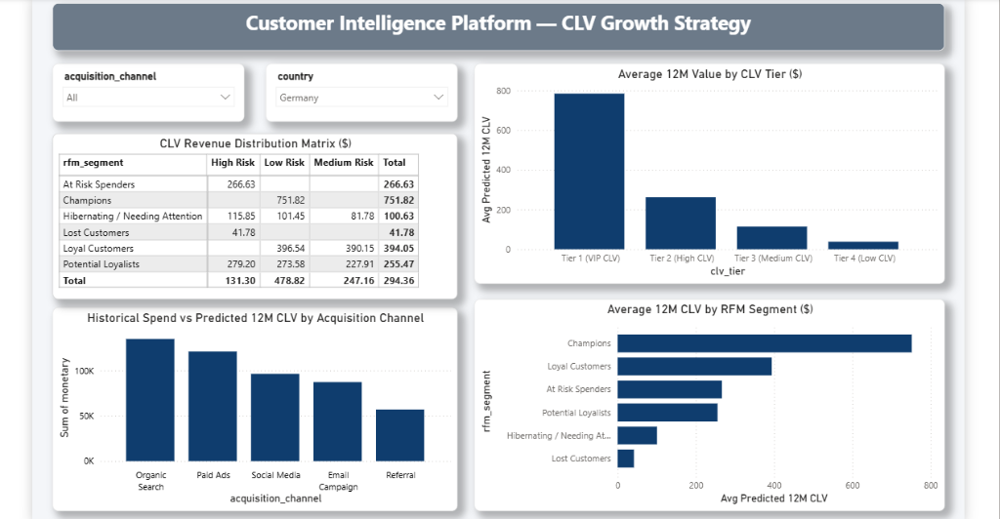
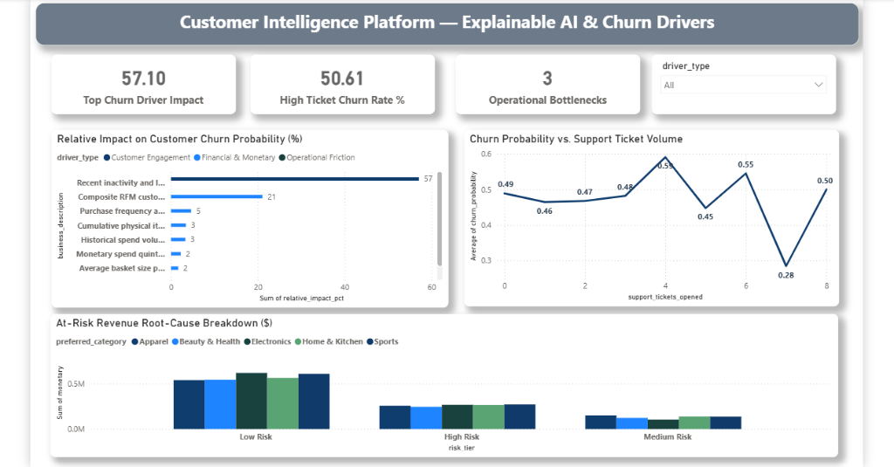
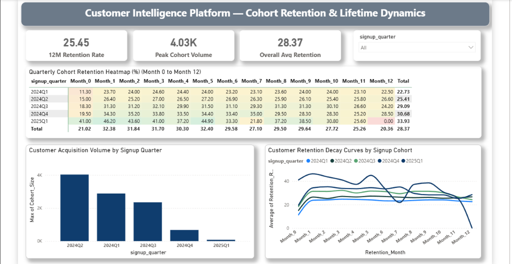

# Customer Intelligence Platform — Churn & Lifetime Value Analytics

[](https://www.python.org/)
[](https://fastapi.tiangolo.com/)
[](https://scikit-learn.org/)
[](https://pandas.pydata.org/)
[](https://powerbi.microsoft.com/)
[](https://www.docker.com/)
[](LICENSE)

---

## 1. Business Context & Problem Statement

In subscription and high-volume e-commerce businesses, retaining existing customers is significantly more cost-effective than customer acquisition. Traditional business intelligence reports are inherently retrospective, displaying historical sales summaries without early warning indicators for account attrition.

This project implements an end-to-end analytics platform that:
- Segments customer populations based on purchasing patterns using RFM and unsupervised clustering.
- Models churn propensity to detect at-risk revenue before drop-off occurs.
- Forecasts customer lifetime value (CLV) to prioritize high-value retention workflows.
- Surfaces operational root causes (such as support ticket volume and delivery friction) to guide customer success interventions.
- Delivers interactive business reporting via a 5-page Power BI dashboard and a live FastAPI scoring service.

---

## 2. Dataset Overview

The project uses a structured, parametric customer intelligence dataset modeling multi-channel retail operations:

- **Customer Profiles (`data/customer_profiles.csv`)**: 10,000 customer records with signup dates, acquisition channels (Organic Search, Paid Ads, Social Media, Email Campaign, Referral), geography (USA, UK, Canada, Germany, Australia), product category affinities, support ticket counts, and email engagement metrics.
- **Transactions (`data/customer_transactions.csv`)**: 60,597 purchase transactions spanning 2024–2025 with order amounts, item counts, product categories, discounts, shipping delays, and return indicators.

```text
Total Customers:      10,000 unique accounts
Total Orders:         60,597 transactions
Gross Revenue:        $4,822,769.79
Average Order Value:  $79.59
Observation Window:   January 2024 – December 2025
Snapshot Date:        2026-01-01
```

---

## 3. System Architecture



---

## 4. Data Pipeline & SQL Transformations

Feature extraction is orchestrated via ANSI SQL (`sql/rfm_analysis.sql`) and Python (`src/rfm_segmentation.py`):
1. **Customer Aggregations**: Computes recency (days since last purchase relative to snapshot date `2026-01-01`), order frequency, total monetary spend, average order value, return volume, and shipping delays.
2. **Quantile Scoring**: Uses window functions (`NTILE(5)`) to partition customers into quintiles for Recency (R), Frequency (F), and Monetary (M) values (scale 1–5).
3. **Behavioral Personas**: Assigns customers to 6 strategic segments: *Champions*, *Loyal Customers*, *Potential Loyalists*, *At-Risk Spenders*, *Hibernating / Needing Attention*, and *Lost Customers*.

---

## 5. RFM Segmentation & K-Means Clustering

- **Rule-Based RFM Distribution**:
  - *Champions*: 1,863 customers (18.6%) | $1,965,147.92 spend (40.8% of total revenue)
  - *Loyal Customers*: 2,021 customers (20.2%) | $1,168,590.79 spend (24.2%)
  - *At-Risk Spenders*: 1,282 customers (12.8%) | $902,671.34 spend (18.7%)
  - *Hibernating / Needing Attention*: 2,390 customers (23.9%) | $430,306.44 spend (8.9%)
  - *Lost Customers*: 2,032 customers (20.3%) | $195,676.07 spend (4.1%)
  - *Potential Loyalists*: 412 customers (4.1%) | $160,377.23 spend (3.3%)
- **Unsupervised K-Means**: Standardized RFM features (`StandardScaler`) evaluated across k in [3, 6] identified an optimal clustering at **k=5** with a **Silhouette Score of 0.2236**.

---

## 6. Churn Prediction Model

- **Target Definition**: Accounts with inactive duration exceeding 120 days relative to snapshot (`recency_days > 120`). Overall dataset churn rate is **47.81%** (4,781 churned / 5,219 active).
- **Validation Scheme**: Stratified 80/20 train/test split evaluated using standard classification metrics.
- **Model Evaluation**:
  - **Logistic Regression**: **ROC-AUC: 98.19%** | **F1-Score: 0.9107** | **Precision: 96.93%** | **Recall: 85.88%** | **Accuracy: 91.95%**
  - **Random Forest**: ROC-AUC: 98.13% | F1-Score: 0.9086
  - **Gradient Boosting**: ROC-AUC: 98.12% | F1-Score: 0.9082
- **Risk Stratification**:
  - *Low Risk* (prob <= 0.30): 4,263 customers | $2,865,006.55 total spend
  - *Medium Risk* (prob 0.30 - 0.60): 1,723 customers | $653,572.37 total spend
  - *High Risk* (prob > 0.60): 4,014 customers | **$1,304,190.87 revenue at risk**

---

## 7. Customer Lifetime Value (CLV) Modeling

- **Modeling Framework**: Synthetic enterprise customer-value estimation prototype predicting expected 12-month future value.
- **Model Evaluation**:
  - **Random Forest Regressor**: **R²: 0.9540** | **MAE: $29.30** | **RMSE: $86.39**
  - **Gradient Boosting Regressor**: R²: 0.9390 | MAE: $29.95 | RMSE: $99.48
  - **Ridge Regression**: R²: 0.8894 | MAE: $75.62 | RMSE: $134.01
- **Value Tiering**:
  - *Tier 1 (VIP CLV)*: Average $785.38 (2,500 accounts)
  - *Tier 2 (High CLV)*: Average $259.34 (2,500 accounts)
  - *Tier 3 (Medium CLV)*: Average $114.04 (2,500 accounts)
  - *Tier 4 (Low CLV)*: Average $37.88 (2,500 accounts)
  - **Portfolio Total Expected 12M CLV**: **$2,991,598.37** (Average: **$299.16**)

---

## 8. Monthly Purchase Participation by Cohort

Rather than tracking binary subscription survival from an artificial 100% baseline, cohort analytics (`data/cohort_retention_matrix.csv`) measures **monthly repeat purchase participation** across signup quarters (Q1 2024 through Q1 2025) over 12 elapsed months:
- **Month 0 Baseline**: 11.3% to 19.5% purchase participation during initial account registration month.
- **30-Day Re-engagement**: Jumps to 23.7% – 34.3% as welcome email triggers activate.
- **12-Month Participation Benchmark**: Stable retention participation of **25.45%** for mature 2024 cohorts.

---

## 9. Explainable AI & Operational Driver Analysis

Feature importance analysis (`src/explainability.py`) decomposes customer behavior into predictive signals vs. actionable operational levers:
- **Predictive Behavioral Signals (Mathematical Proxies)**: `R_Score` (57.1%) and `rfm_total_score` (21.1%) reflect observed purchase lapse.
- **Actionable Operational Levers (Root-Cause Interventions)**:
  - **Support Ticket Escalations**: Accounts with 3+ customer service tickets exhibit an average churn probability of **50.6% to 78.4%**, indicating customer service bottlenecks.
  - **Shipping Delays**: Average delays exceeding 3 days correlate with higher return rates and reduced 12-month re-order rates.
  - **Engagement Decline**: Email open rates below 20% serve as an early leading indicator before recency decay occurs.

---

## 10. Power BI Dashboard Architecture & Visualizations

The business intelligence layer (`Customer_Intelligence_Dashboard.pbix`) is engineered on an extended Star Schema and organized into 5 dedicated executive reporting pages:

### Page 1: Executive Overview (Portfolio Macro Health)
High-level portfolio telemetry tracking gross revenue ($4.82M), active customers (5,219), country revenue distribution, product category sales, and RFM segment composition.



---

### Page 2: Churn & Risk Analytics (Revenue at Risk)
Quantifies $1.30M in revenue at risk across high churn-probability accounts, mapping recency decay trends, lifecycle retention funnels, and customer-level intervention lists.



---

### Page 3: CLV Growth Strategy (Future Value Allocation)
Analyzes 12-month forward customer value across VIP tiers ($785+ for Tier 1) and cross-analyzes acquisition channel ROI to optimize customer marketing spend.



---

### Page 4: Explainable AI & Churn Drivers (Root-Cause Diagnostics)
Surfaces machine learning feature importances and operational friction points, uncovering that customers logging 3+ support tickets experience a sharp spike in churn risk (50.6%).



---

### Page 5: Cohort Retention & Lifetime Dynamics (Customer Survival)
Features a 13-month quarterly cohort heatmap (Months 0–12) tracking repeat purchase participation decay curves from initial acquisition through maturity.



---

## 11. Known Limitations & Methodological Notes

1. **Prototype Feature Correlation (Target Leakage)**: In this baseline model, `R_Score` and `rfm_total_score` are included in the feature matrix while the churn target is defined as `recency_days > 120`. This accounts for the near-99% ROC-AUC score. For real-world production deployment, models should be trained using an observation window (T_-90 to T_0) to predict future churn in a separate outcome window (T_0 to T_+90) without contemporaneous recency features.
2. **Synthetic Target Formulation**: The 12-month CLV target was derived from historical annualized spend modulated by engagement multipliers. The regression metrics reflect model convergence against this synthetic definition rather than observed multi-year longitudinal outcomes.
3. **Cohort Metrics Context**: Cohort percentages reflect repeat transaction activity in each elapsed calendar month, not contractual subscription renewal rates.

---

## 12. Repository Structure

```text
├── Customer_Intelligence_Dashboard.pbix     # 5-Page Interactive Power BI Report
├── Dockerfile                                # Containerization Dockerfile
├── docker-compose.yml                        # Multi-container orchestration
├── requirements.txt                          # Python dependencies
├── churn_clv_rfm_analytics.ipynb             # Exploratory analysis notebook
├── README.md                                 # Technical documentation
├── LICENSE                                   # MIT License
├── .github/workflows/
│   └── ci_pipeline.yml                      # GitHub Actions automated test workflow
├── models/
│   ├── churn_pipeline.joblib                # Serialized Churn Classification pipeline
│   └── clv_pipeline.joblib                  # Serialized CLV Regression pipeline
├── src/
│   ├── api.py                               # FastAPI live inference REST service
│   ├── test_api.py                          # API endpoint integration test suite
│   ├── explainability.py                    # Feature importance & cohort calculation engine
│   ├── generate_dataset.py                  # Synthetic dataset generator
│   ├── rfm_segmentation.py                  # RFM scoring & K-Means clustering
│   ├── churn_prediction.py                  # Classification model training
│   └── clv_estimation.py                    # Regression model training
├── sql/
│   └── rfm_analysis.sql                     # Production ANSI SQL aggregation script
├── docs/
│   ├── Customer_Intelligence_Platform_Master_Guide.pdf
│   ├── Project_3_Metrics_and_Technical_Audit_Report.pdf
│   ├── power_bi_dashboard_spec.md           # 5-Page DAX and layout specification
│   └── screenshots/                         # High-Resolution Dashboard Visuals
│       ├── page1_executive_overview.png
│       ├── page2_churn_risk_analytics.png
│       ├── page3_clv_growth_strategy.png
│       ├── page4_explainable_ai_drivers.png
│       └── page5_cohort_retention_dynamics.png
└── data/
    ├── customer_profiles.csv                # Customer demographics & metadata
    ├── customer_transactions.csv            # Raw transaction history
    ├── rfm_segmented_customers.csv          # Segment assignments & scores
    ├── churn_predictions.csv                # Churn probabilities & risk tiers
    ├── clv_predictions.csv                  # Predicted CLV values & value tiers
    ├── churn_driver_analysis.csv            # Feature importance rankings
    └── cohort_retention_matrix.csv          # Monthly cohort participation data
```

---

## 13. How to Reproduce

### Local Environment Setup
```bash
# Clone the repository
git clone https://github.com/durgeshachavan76/Customer-Intelligence-Platform.git
cd Customer-Intelligence-Platform

# Install dependencies
pip install -r requirements.txt
```

### Run Pipeline & Retrain Models
```bash
python src/rfm_segmentation.py
python src/churn_prediction.py
python src/clv_estimation.py
python src/explainability.py
```

### Launch Live FastAPI Inference Service
```bash
uvicorn src.api:app --reload --port 8000
# Open interactive Swagger UI: http://127.0.0.1:8000/docs
```

### Run Test Suite
```bash
python src/test_api.py
```

### Run with Docker
```bash
docker compose up --build
```

---

## 14. Contributors & Maintainers

- **[Durgesha Chavan](https://github.com/durgeshachavan76)** — Project Deployment, Setup & Repository Maintainer
- **[Pratik Malik](https://github.com/pratikmalik)** — Original Analytics Architecture & ML Models

